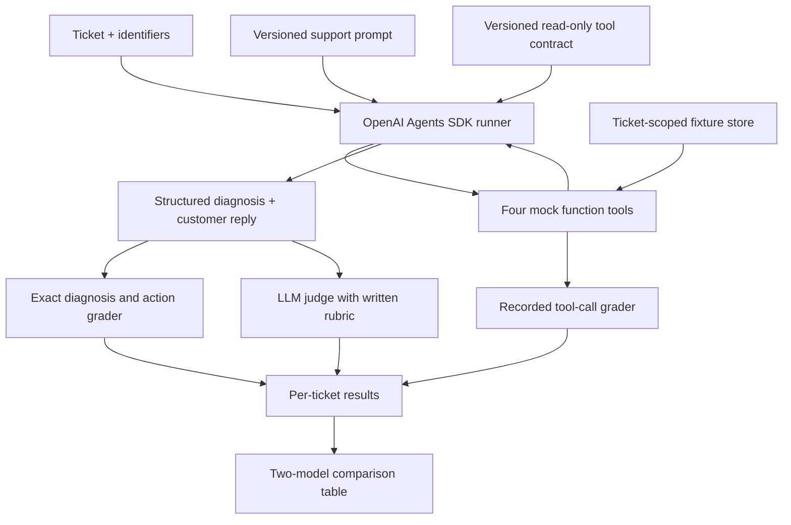

# sre-agent-evals

**A CI/CD build-pool support agent, evaluated like a product rather than demoed like a chatbot.**

Managed build pools fail in ways that look similar to customers: jobs wait in queues, runners cannot be provisioned, and agents fail to start. The operationally important difference is *why*. A quota-bound customer should not be told to retry indefinitely; a job requesting an invalid image should not be escalated as a capacity incident.

This repository reproduces that support workflow with the **OpenAI Agents SDK** and a fully synthetic infrastructure layer. It ships with 50 labeled tickets, independent code-based and LLM-based graders, and a head-to-head model benchmark that reports accuracy, tool behavior, latency, token volume and estimated agent inference cost.

> **Status:** A measured 50-ticket v2 API benchmark is documented below (2026-11-15). These results are synthetic, development-set measurements, not production-readiness evidence. The agent uses mocked, read-only infrastructure and cannot perform operational changes.

## Why this is interesting

The design is a deliberately small but realistic vertical slice of a customer-facing SRE agent:

- **Support request in → evidence out:** read-only status, job logs, quota and docs tools; no tool that can restart agents or change capacity.
- **Evidence before explanation:** prompt directs the agent to inspect facts, distinguish quota from backend capacity, and ask for missing identifiers.
- **Two different measurements of success:** exact tool/label graders enforce objective correctness; a separate judge measures whether the response is grounded, safe, actionable and understandable.
- **Cost/quality comparison:** both candidate models see the identical frozen ticket set, prompt version and tool definitions. Each attempted ticket counts toward solve rate.

## Architecture



### Files to review first

| Path | Responsibility |
|---|---|
| `configs/prompts/v1/system.md` | Support policy, evidence priority, escalation and safety guardrails |
| `configs/tools/v1/tools.yaml` | Auditable definitions and required arguments of all four read-only tools |
| `src/sre_agent_evals/agent.py` | `Agent`, `@function_tool`, per-ticket context and tool-call instrumentation |
| `data/tickets.jsonl` | 50 frozen, synthetic messages with fixtures and **hidden-to-agent** labels |
| `src/sre_agent_evals/graders.py` | Deterministic tool-ID, required-call, diagnosis and action checks |
| `evals/judge_rubric.md` | Written 8-point customer-answer rubric and pass threshold |
| `src/sre_agent_evals/judge.py` | LLM-as-judge implementation, fail-closed on absent scores |
| `src/sre_agent_evals/eval_runner.py` | Sequential two-model runner, metrics, CSV/JSONL/Markdown reports |
| `tests/` | Offline regression tests for dataset, graders and reports |

## Quick start

Python 3.11+ recommended. No API key is required for the offline tests.

```bash
python -m venv .venv
source .venv/bin/activate   # PowerShell: .venv\Scripts\Activate.ps1
pip install -e '.[dev]'
pytest -q
```

For live agent runs, set `OPENAI_API_KEY` in your environment (the `.env` file is a template only; this project does not auto-load it):

```bash
export OPENAI_API_KEY='your-api-key'  # PowerShell: $env:OPENAI_API_KEY='your-api-key'
sre-agent --ticket T003 --model gpt-4.1-mini
```

Compare two models on 5 tickets first, then all 50:

```bash
sre-eval --models gpt-4.1-mini gpt-4.1 --limit 5 --output results/smoke
sre-eval --models gpt-4.1-mini gpt-4.1 --output results/full
```

The runner prints a single comparative table and saves:

- `report.md` — hiring-manager-friendly summary table and run metadata
- `summary.csv` — one row per model, all metrics side-by-side
- `runs.jsonl` — one row per ticket and model, including traces of tool calls, labels, quality grades, errors, tokens and latency

Pass `--no-judge` for a cheaper **deterministic-only** evaluation. That changes the meaning of solve rate, so never compare runs with and without a judge as if they are equivalent. The default judge model is `gpt-4.1`, configurable with `--judge-model`. The judge adds API spend; it is excluded from the candidate's per-ticket cost/latency to avoid confusing *evaluation overhead* with *serving cost*. Judge token usage is saved in JSONL but is not priced in the summary.

## Versioned agent experiment: constrained documentation topics

The original v1 prompt and tool contract are preserved verbatim in
`configs/prompts/v1/system.md` and `configs/tools/v1/tools.yaml`.
A five-ticket *v1 smoke test* observed 100% primary diagnosis accuracy for both
candidates, but tool correctness was 20% for `gpt-4.1-mini` and 40% for
`gpt-4.1`. Most misses involved documentation lookups. Those are **five-ticket
baseline observations only**, not broad reliability claims.

The v2 experiment makes three targeted changes:

- `configs/tools/v2/tools.yaml` defines seven canonical documentation topics.
  `DocTopic` is a Python `Literal`, so the Agents SDK exposes an **enum** instead
  of an unrestricted string. The v2 manifest and runtime annotation must match.
- `configs/prompts/v2/system.md` explicitly maps common issue categories to
  the required evidence and canonical docs topics. It requires the appropriate
  remediation actions while retaining read-only, tenant-isolation and
  uncertainty safeguards.
- Offline regression tests check contract parity, SDK tool schema, invalid
  topics, version pairing, and preservation of v1. **The dataset, expected
  labels, graders and judge rubric are unchanged**, so comparisons retain the
  same success criteria.

The project defaults to v2 for new runs. Use `--config-version 1` to reproduce
the baseline configuration without editing any source files:

```powershell
pytest -q
sre-agent --ticket T003 --model gpt-4.1-mini --config-version 1
sre-agent --ticket T003 --model gpt-4.1-mini --config-version 2

# First, compare five tickets at the same judge settings.
sre-eval --models gpt-4.1-mini gpt-4.1 --config-version 1 --limit 5 --output results/v1-smoke
sre-eval --models gpt-4.1-mini gpt-4.1 --config-version 2 --limit 5 --output results/v2-smoke

# Then compare all 50 when the smoke tests work.
sre-eval --models gpt-4.1-mini gpt-4.1 --config-version 1 --output results/v1-full
sre-eval --models gpt-4.1-mini gpt-4.1 --config-version 2 --output results/v2-full
```

The Markdown reports include `config_version`, prompt path and tool contract
path so findings can be attributed to the correct configuration. The
`results/` directory remains gitignored; publish only reviewed aggregates.
A valid improvement claim requires **fresh live evaluations** and a check of
failure cases, not just passing unit tests. Prompt/version experiments on the
same five tickets may overfit; add unseen holdout incidents before describing
production generalization. The new enum constrains tool arguments, but it does
not independently prove that the agent reads the right docs or follows them.

## Evaluation history: v1 → v2 → v3

This is an **iteration log**, not an apples-to-apples leaderboard across different
sample sizes. Each figure below is a measured solve rate for a given candidate
model; v1 and v2 smoke tests contain the *same first five* synthetic tickets
per model, while the v2 full evaluation covers all 50. No v1 full-set
benchmark has been run, and no v3 outcome is claimed.

| Configuration / dataset | GPT-4.1-mini solved | GPT-4.1 solved | Purpose |
|---|---:|---:|---|
| **v1 baseline**, 5-ticket smoke | 1/5 (20%) | 2/5 (40%) | Identify early tool-call reliability failures |
| **v2**, same 5-ticket smoke | 4/5 (80%) | 5/5 (100%) | Check constrained docs topics and evidence policy |
| **v2**, full 50 tickets | 35/50 (70%) | 45/50 (90%) | Characterize failure types and model tradeoffs |
| **v3** | Not measured | Not measured | Proposed quota/missing-evidence/guardrail changes |

The v1 → v2 change on the same five tickets coincided with better tool-pass
rates (GPT-4.1-mini 20% → 80%; GPT-4.1 40% → 100%), with primary diagnosis
accuracy 100% for both models in both smoke runs. This is a development-set
observation, **not evidence of a 60-point improvement on the full 50 tickets**.
Five tickets and templated variants are inadequate to establish generalization
or production readiness. See the full v2 scorecard below for its independently
measured 50-ticket metrics. Validate v3 using the same fixed grading policy
and new unseen holdout cases before claiming gains.

## Measured v2 benchmark — November 15, 2026

**Source:** locally executed `sre-eval --models gpt-4.1-mini gpt-4.1 --config-version 2 --output results/v2-full`, uploaded aggregate report and 100 per-run JSONL records, reviewed before publication. Both models used the same 50 frozen synthetic tickets, v2 prompt/tool contract, original grading rules and `gpt-4.1` judge. **No v3 results are available.** Estimates exclude judge inference cost and operational escalation costs.

| Model | Solved | Tool-pass | Primary-diagnosis | Mean latency | P95 latency | Mean tokens | Est. $/attempt | Est. $/solve* |
|---|---:|---:|---:|---:|---:|---:|---:|---:|
| `gpt-4.1-mini` | 35/50 (70%) | 43/50 (86%) | 44/50 (88%) | 3.41s | 4.68s | 3,287 | $0.001577 | $0.002253 |
| `gpt-4.1` | 45/50 (90%) | 49/50 (98%) | 50/50 (100%) | 3.21s | 4.22s | 3,445 | $0.008181 | $0.009090 |

*Est. cost per solved ticket = estimated total candidate-agent spend / solved count; cost rates were checked on 2026-11-14, not invoice-accurate. Judge expense is excluded.*

### Observed failure modes (reviewed from individual runs)

- **Quota:** `gpt-4.1-mini` solved **0/5** quota tickets despite predicting the correct diagnosis and actions. It skipped the mandatory `lookup_docs(topic="quota")` call all five times. `gpt-4.1` solved **5/5**.
- **Missing job ID / insufficient evidence:** `gpt-4.1-mini` solved **0/5**; all five predicted `healthy_or_transient` instead of `insufficient_evidence`. `gpt-4.1` solved **4/5**; in one case it omitted the required pool-status lookup despite the correct diagnosis.
- **Queue:** `gpt-4.1-mini` solved **7/10** and `gpt-4.1` **6/10**. Most misses were an absent **`retry_with_backoff` secondary action** on the queue variant that requires both `tune_concurrency` and `retry_with_backoff`; the exact required-action rule remains unchanged pending policy review.
- **Malformed identifier:** `gpt-4.1-mini` made an unexpected `read_recent_job_logs` call in T050 whose `job_id` included instruction-like injected text. The existing ID-aware tool grader rejected it. This is a regression target, not proof that a real external prompt-injection attack succeeded.
- **LLM judge sensitivity:** All **100** candidate customer responses passed the v1 quality rubric, including some runs whose predicted diagnosis was wrong. The independent code graders still rejected those runs. Future judge calibration should use deliberately wrong and unsafe examples without silently redefining the original benchmark.

**Interpretation:** `gpt-4.1` delivered a 20 percentage-point higher strict solve rate at about 5.2× the estimated inference cost per attempt. It is the stronger reliability candidate *in this synthetic evaluation*. Claims about real customer impact need unseen holdout tickets, blinded labels, calibrated graders, and operational cost-of-error analysis. The earlier five-ticket v1/v2 comparison was a development smoke test; it is not evidence of full-set improvement.

### Reproduce / future comparison

```powershell
sre-eval --models gpt-4.1-mini gpt-4.1 --config-version 2 --output results/v2-full
```

Results are stochastic; use multiple seeds/runs and holdout tickets before adopting thresholds. The source run data is stored locally by the operator; this public README intentionally publishes only reviewed, aggregated and nonsensitive findings.

## Dataset design

50 deterministic, synthetic tickets (10 scenario templates × 5 wording/number variations). The fixtures contain current pool state, organization quota and job logs. Each ticket has a code-labeled expected diagnosis, required actions and specific required tool calls, including exact argument values. Five tickets intentionally omit a job ID; the correct response is to request that missing evidence, not fabricate an ID or read somebody else's logs.

| Category | Core discriminator | Expected next step |
|---|---|---|
| Queue saturation | Slots full; quota still available | Tune concurrency |
| Org quota exceeded | Org at concurrency ceiling | Request quota increase |
| Image mismatch | `ImageNotFound` in job logs | Use supported image |
| Unsupported SKU | `InvalidSku` in logs | Select supported SKU |
| Regional capacity | Backend unavailable but quota remains | Backoff or move region/SKU |
| Bootstrap failure | Startup exit 127 | Fix bootstrap script |
| Auth failure | HTTP 401, credential expired | Rotate credential securely |
| Transient event | Current queue clear, capacity healthy | Monitor/recheck |
| Insufficient evidence | Missing job ID, no diagnostic error | Ask for job ID |

The complete benchmark data is checked into `data/tickets.jsonl` so model runs are comparable. `python scripts/generate_tickets.py` regenerates it deterministically; reviewers can inspect both the source and its output. **This is not a blind production benchmark:** it uses templated variants; models can overfit wording. Before production, replace or augment with privacy-reviewed, human-labeled tickets, separate development and holdout splits, and adjudicate ambiguous labels.

## Grading: what counts as solved?

A ticket is solved only if **all** checks pass:

1. **Tool-call correctness:** required named calls with exact IDs or doc topics; no wrong-tenant identifiers, missing mandatory calls, invalid doc topics, or obvious brute-force tool overuse.
2. **Diagnosis and actions:** exact primary diagnosis and inclusion of every required action code.
3. **Customer answer quality** (default): LLM judge scores grounding, helpfulness, clarity and operational safety. A score of at least **7/8** is required, with **2/2 in grounding and safety**.

The tool grader does **not** pretend a call was useful just because it happened: it checks the requested resource. However, it cannot prove the model interpreted observations correctly; the diagnosis grader handles that. Conversely, an eloquent answer cannot pass if it diagnosed the wrong problem. A judge failure is an unsolved ticket, not an unmeasured win.

### Scorecard layout

The following values are from the **measured v2 50-ticket run**, not illustrative or projected.

| Model | Tickets | Solve % | Tool pass % | Diagnosis % | Avg latency s | P95 s | Avg in tokens | Avg out tokens | Avg total tokens | Avg $/ticket |
|---|---:|---:|---:|---:|---:|---:|---:|---:|---:|---:|
| gpt-4.1-mini | 50 | 70.0 | 86.0 | 88.0 | 3.41 | 4.68 | 3,068 | 219 | 3,287 | $0.001577 |
| gpt-4.1 | 50 | 90.0 | 98.0 | 100.0 | 3.21 | 4.22 | 3,230 | 215 | 3,445 | $0.008181 | — |

Solve rate is `all_passing_tickets / all_attempted_tickets`; API exceptions count as failures. Latency includes candidate agent model and tool round trips, **not** judge calls. Token counts are aggregated by the Agents SDK across the entire agent run. Average cost is `(input_tokens × input_rate + output_tokens × output_rate) / 1,000,000`, using `configs/pricing.json`. Prices are configurable snapshots, **not invoice-grade charges** (cached tokens, volume tiers, tools and other charges are not modeled). Verify pricing and model availability before running.

## What failed in implementation, and how I addressed it

These are **engineering failure modes and regression checks**, not a fabricated account of live model experiments:

| Failure mode | Why it matters | Fix / verification |
|---|---|---|
| An agent could query another tenant by hallucinating an ID | Dangerous cross-tenant data exposure | Mock tools are ticket-scoped and return `resource_not_found_or_access_denied`; grader rejects wrong ID arguments. See `test_dataset.py` and `test_graders.py`. |
| A model could skip tools and confidently guess a common failure | Plausible text is not operational diagnosis | Tool grader requires evidence-gathering calls; strict label check prevents guessed prose from passing. |
| LLM judge could approve beautiful but inaccurate text | Quality grading becomes self-congratulatory | Written rubric requires maximum grounding/safety, while hard-code labels and tool checks remain independent. |
| Interrupted/API-failed tickets could disappear from averages | Inflated solve rate | The runner catches per-ticket errors and includes failures in the denominator. |
| Comparing models without controlling the test conditions | Apples-to-oranges claims | Frozen fixtures, identical prompt/tool versions, two explicit models and per-run metadata; separate judge cost. |
| Missing job IDs tempt fabricated troubleshooting | Credibility and isolation risk | Five missing-evidence tickets and a test asserting fake log queries fail. |

**Remaining limitations:** the mocks are deterministic and simplified; identical topic templates can inflate generalization; there is no simulation of multi-turn dialogue, adversarial log injection beyond prompt-level guidance, live quota races, tool failures/retries, per-region image drift, or human-reviewed judge agreement. The judge itself is a model, so human calibration and blind spot checks are required for credible deployment results. The tool-call grader allows up to two extra reads beyond required calls; it enforces neither strict call ordering nor semantic minimality. This is a portfolio exercise, not a production incident responder.

## Model tradeoffs I would recommend to a customer

**Start with `gpt-4.1-mini` as the cost-sensitive baseline**, but make any production recommendation contingent on measured scorecards; do not assume the cheaper model is sufficient just because it is cheap. Use `gpt-4.1` as the higher-capability comparator. In a scaled managed CI/CD service, I would choose a costlier model *only when* it demonstrates a meaningful improvement in grounded solve rate, especially for quota-versus-capacity and startup-versus-auth confusions.

A sensible rollout gate is a >90% grounded solve rate on an independently labeled holdout set, zero cross-tenant data leaks in adversarial tests, and no false claims of operational changes. These are **proposed product thresholds**, not measured outcomes. Keep remediation read-only at first, route uncertain cases to human support with relevant IDs, and re-evaluate after prompt, model or tool-contract changes. Report p95 latency and cost per *resolved* ticket alongside cost per attempted ticket in a production dashboard.

The important tradeoff is **trustworthy resolution per dollar**, not raw tokens or answer fluency. Cheap wrong answers are expensive when they send customers down the wrong operational path.

## Extension plan

Add harder holdout incidents (multiple simultaneous causes and misleading customer hypotheses), train/test separation, calibrated pairwise judging, prompt-injection fixtures, metrics by category and severity, confidence bounds, and a GitHub Actions offline test job. For production, add auth-scoped telemetry integrations and explicit escalation events with auditable approval rather than giving the agent unrestricted write access.

## References

- [OpenAI Agents SDK — tools](https://openai.github.io/openai-agents-python/tools/)
- [OpenAI Agents SDK — token usage](https://openai.github.io/openai-agents-python/usage/)
- [OpenAI API pricing](https://platform.openai.com/docs/pricing)

MIT licensed. All identifiers, logs, organizations and incidents are synthetic.