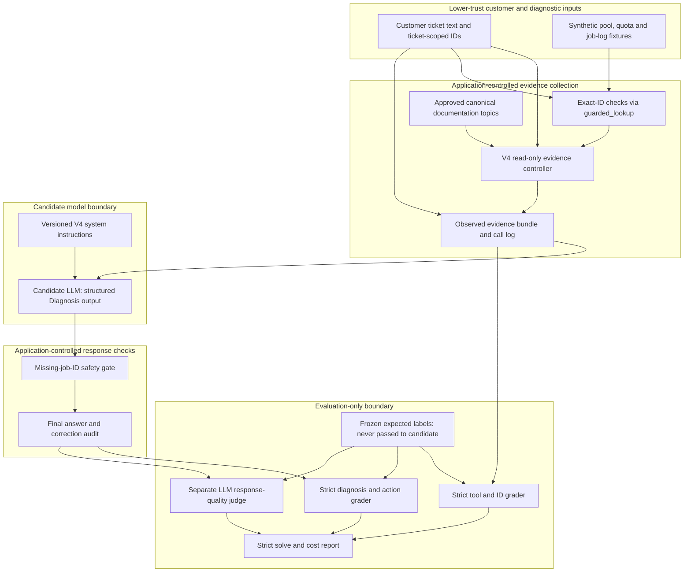

# Architecture and trust boundaries

V4 is a **read-only synthetic support workflow**. It deliberately moves
diagnostic tool selection out of the candidate LLM and into a bounded,
observable controller. This is a system-design experiment, not evidence
that a model can independently select the right tools in production.

## V4 data flow

The paths above represent **logical trust boundaries**; they do not imply
separate services or a deployed security perimeter. The implementation is
in-process and uses deterministic fixtures.

## Trust boundary 1: untrusted ticket and observed diagnostics

The ticket message and job log events are **data**, not instructions.
`EvidenceBundle.model_input()` explicitly labels the customer ticket
untrusted and collected diagnostics as observations. This helps specify
the intended hierarchy, but a text label alone cannot guarantee that an
LLM will ignore all injected instructions.

`guarded_lookup()` validates the shape of an org, pool, or job ID,
checks it against the allowed ID for the current ticket, and returns
an access-denied/not-found response on mismatch. It never interpolates
a supplied identifier into a live network or database query. These are
fixture-level controls, not a production authentication system.

Sources:
[orchestration.py](../src/sre_agent_evals/orchestration.py),
[security.py](../src/sre_agent_evals/security.py).

## Trust boundary 2: controller to candidate model

The V4 controller calls read-only fixture accessors for pool status,
job logs when a job ID is present, and quota when observations warrant
it. It selects a canonical documentation topic from observed error
markers or resource conditions. It does **not** read
`ticket.expected` or use expected diagnosis/action labels to choose
what the candidate sees.

It records each read as a tool-call trace and combines source-tagged
results into the evidence bundle. In V4 the candidate model has
**no independent diagnostic tools**, because
`build_agent()` exposes an empty tool list. The candidate receives
the bundle and versioned system instructions, then generates a
structured `Diagnosis` with a code, action list, evidence and
customer-facing explanation.

This shifts procedural reliability to ordinary code, but also makes
the routing policy an application dependency. A controller bug,
outdated canonical documentation, or bad fixture can bias *all*
candidate models in the same way. Tool-grade pass rates in V4 are
therefore **controller-level** observations.

Sources:
[orchestration.py](../src/sre_agent_evals/orchestration.py),
[agent.py](../src/sre_agent_evals/agent.py),
[schemas.py](../src/sre_agent_evals/schemas.py).

## Trust boundary 3: candidate answer to safety gate

`enforce_missing_job_boundary()` is a narrow deterministic
postprocessor. When a customer reports an unexplained failed job
without a job ID and the observed pool appears healthy, it prevents
an unsupported healthy/transient conclusion by returning an
`insufficient_evidence` diagnosis and asking for the job ID.

The runner records both the **raw candidate answer** and the final
answer, plus whether a correction was applied. This gate is not
a general-purpose safety filter. The recorded V4 development and
challenge evaluations did not require a controller correction.

Sources:
[orchestration.py](../src/sre_agent_evals/orchestration.py),
[eval_runner.py](../src/sre_agent_evals/eval_runner.py).

## Trust boundary 4: evaluation-only labels and independent graders

Expected diagnoses, required actions, and required reads belong
to the **evaluation harness**. They are not included in the
candidate's V4 evidence bundle. After the response has been produced,
the strict code graders compare observed tool calls and IDs with
required calls, then check diagnosis and required actions.

A separate LLM judge evaluates response quality using an explicitly
versioned rubric. **Important distinction:** the historical judge
payload includes the ticket's expected labels and fixture evidence.
It is a deliberately privileged *evaluator*, not another candidate
agent. Neither the judge nor its input should be treated as a
production response-generation boundary. The combined strict solve
requires all enabled checks to pass.

Rubric V1 and the GPT-4.1 judge were kept fixed in the published
historical/current-model comparison to avoid changing the scoring
instrument alongside the candidate. Experimental rubric V2 and V3
results are reported separately. The judge can still be inconsistent
or sensitive to untrusted content embedded in evidence, so human
calibration is a remaining requirement.

Sources:
[graders.py](../src/sre_agent_evals/graders.py),
[judge.py](../src/sre_agent_evals/judge.py),
[eval_runner.py](../src/sre_agent_evals/eval_runner.py).

## Safety and reproducibility limits

- All diagnostic reads are mocked and read-only. No action in this
  prototype restarts a runner, rotates a credential, or changes capacity.
- Exact-ID fixture checks are not proof of real multi-tenant
  authorization or isolation.
- Untrusted ticket/log text is passed through to model and judge
  contexts. The code signals the trust boundary, but does not offer
  a formally proven injection defense.
- V4's deterministic controller reduces tool selection errors but
  does not guarantee that a generated explanation is safe or correct.
- The data are synthetic and repeatedly studied. The benchmarks
  do not measure real incidents, production latency, infrastructure
  overhead, escalation outcomes, or risk-weighted error costs.
- Do not change judge prompts or frozen scoring labels while claiming
  a directly comparable historical benchmark. Policy V2 scores
  are separately labeled post-hoc replays.

## Explore further

- [Documentation index](README.md)
- [Architecture and Evaluation Decision Log](architecture_decision_log.md)
- [Current-model validation and failure analysis](current_model_validation_2026_11.md)
- [Queue-action policy V2](queue_action_policy_v2.md)
